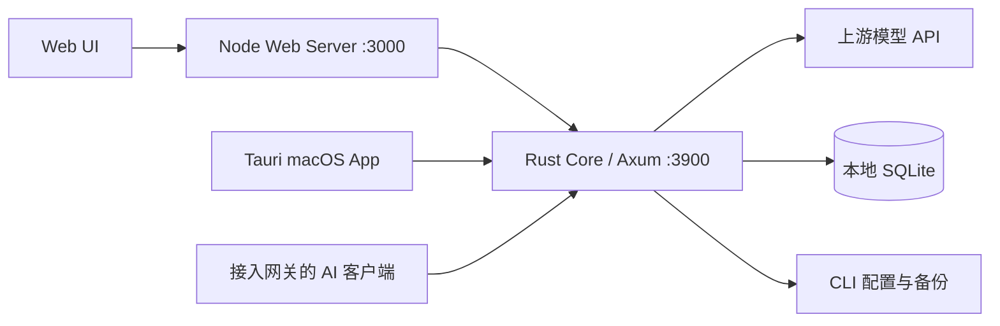

# codexswitch

**在一个本地控制台里管理 Claude Code、Codex 和 Gemini 的 API 通道、配置与用量。**

Local provider switching, proxy routing, and request visibility for AI coding clients.

[下载 macOS 预览版](https://github.com/eust-w/codexswitch/releases/tag/preview-0.1.0) · [使用指南](docs/usage.md) · [API 参考](docs/api.md) · [开发与构建](docs/development.md) · [反馈问题](https://github.com/eust-w/codexswitch/issues)

codexswitch 提供 macOS 桌面应用和本地 Web 界面，共用 Rust 核心与 SQLite 数据。适合经常切换模型服务、为不同项目分发访问密钥，以及需要追踪请求和排查调用失败的开发者。

> 当前提供 `preview-0.1.0` 预览安装包，支持 Apple Silicon、macOS 12+，尚未签名和公证。下文介绍的是 `main` 分支的实现范围；安装包功能以对应 Release 为准。

## 能做什么

| 能力 | 具体用途 |
| --- | --- |
| API 通道管理 | 新增、编辑、排序和测试 Provider，同步上游模型列表，配置模型名映射 |
| 客户端配置切换 | 写入 Claude Code、Codex CLI/Desktop、Gemini CLI 的本地配置，原子替换前备份旧文件 |
| 本地模型网关 | 转发 Claude Messages、OpenAI Chat Completions/Responses、模型列表和 Gemini `generateContent` 请求 |
| 协议适配 | 将 Claude Messages 请求转换为 OpenAI-compatible Chat Completions，并转换返回结果 |
| 租户与密钥 | 管理使用者、项目和入站 Key，设置请求数与 token 配额、撤销 Key、查看用量与估算成本 |
| 请求排查 | 按项目、Provider、模型查看统计、错误和日志，按顺序查看 request/response 记录 |
| 测试与数据导出 | 通过沙盒发起真实上游调用；从已采集的正文预览生成 JSONL 蒸馏数据 |

### 客户端支持

| 客户端 | Provider 与配置切换 | 界面内启动 CLI 进程 |
| --- | --- | --- |
| Claude Code | 支持 | 支持，需本机安装 `claude` |
| Codex Workspace CLI | 支持 | 暂未实现 |
| Codex Desktop | 支持，与 CLI 共用 Codex 配置 | 暂未实现 |
| Gemini CLI | 支持 | 支持，需本机安装 `gemini` |

客户端、上游 API 凭据和可用模型需自行准备。沙盒测试会真实请求所配置的上游，可能产生服务商费用。

## 安装与启动

### macOS 桌面版

1. 下载 [codexswitch_0.1.0_arm64.dmg](https://github.com/eust-w/codexswitch/releases/download/preview-0.1.0/codexswitch_0.1.0_arm64.dmg)。
2. 打开 DMG，将 `codexswitch.app` 拖入 `Applications`。
3. 启动应用；若因未签名被 macOS 拦截，可在确认下载来源后前往「系统设置 → 隐私与安全」允许打开。

使用安装包无需安装 Node.js 或 Rust。目前未提供 Intel Mac、Windows 或 Linux 的预构建安装包。

也可以通过 [Homebrew Tap](https://github.com/eust-w/homebrew-tap) 安装同一预览版：

```sh
brew tap eust-w/tap
brew install --cask codexswitch
```

### 从源码运行 Web 版

以下步骤以 macOS 为准。准备 Node.js 20+、npm、Rust stable（含 `cargo`）及 Xcode Command Line Tools；Rust 包声明的最低版本为 1.85。系统依赖见 [Tauri prerequisites](https://v2.tauri.app/start/prerequisites/)。

```sh
git clone https://github.com/eust-w/codexswitch.git
cd codexswitch
npm ci
npm run dev:web
```

打开 **http://localhost:3000**。该命令同时启动 Web 服务和 Rust core；首次启动需要编译 Rust，页面出现后仍需等待 core 就绪。

```sh
curl --fail http://127.0.0.1:3900/health
```

已有桌面应用或独立 core 占用 `3900` 时，让 Web 连接现有实例：

```sh
CODEXSWITCH_CORE_URL=http://127.0.0.1:3900 npm run dev:web
```

端口调整、独立 core、源码构建和验证命令见 [开发指南](docs/development.md)。

## 第一次使用

1. 进入「AI 通道管理 / API Channels」，添加 Provider，填写应用类型、协议、Base URL 和 API Key。
2. 获取模型列表，选择上游支持的模型，测试连接；需要别名时设置 Model Mapping。
3. 需要切换客户端配置时，执行 Provider 切换。Codex CLI 与 Desktop 共用 `~/.codex/config.toml`。
4. 需要经过本地网关时，点击侧栏 `START`，将客户端指向 core 地址 `http://127.0.0.1:3900`；OpenAI-compatible 客户端通常使用带 `/v1` 的 Base URL。
5. 在「沙盒连通测试」验证调用，再到「项目遥测」「请求审计」或「网关日志分析」排查结果。

**配置切换与网关转发是两个操作。** 切换写入的是选定 Provider 的配置；需要网关统计、入站 Key 或协议适配时，还须让客户端请求经过网关。完整示例见 [使用指南](docs/usage.md)。

## 数据与访问边界

| 数据 | 默认位置或行为 |
| --- | --- |
| Provider、模型、网关配置和记录 | `~/.codexswitch/codexswitch.db` |
| 切换前的配置备份 | `~/.codexswitch/backups/` |
| JSONL 导出 | `~/.codexswitch/distillation/` |
| 请求和响应正文 | 默认不采集；可手动开启有限长度的正文预览 |
| Codex 登录凭据 | 切换配置时保留 `~/.codex/auth.json` |

- **本地存储不等于加密存储。** Provider 上游密钥保存在本地数据库中，界面和 API 响应会掩码展示；签发的网关入站 Key 则仅存 SHA-256 哈希和短前缀，原文只返回一次。
- **正文脱敏有边界。** JSON 预览按敏感字段名脱敏，不能保证识别普通文本或对话中出现的秘密；导出来源是预览，可能截断，不是完整会话归档。
- **当前面向可信本地环境。** Rust core 默认监听 `127.0.0.1:3900`；源码 Web 服务监听 `0.0.0.0:3000`，并转发管理 API。管理 API 没有登录鉴权，网关入站 Key 不保护管理接口，不应直接暴露到不可信网络。
- 用量和成本包含估算值，不能替代上游账单。普通模型请求仍会发送到所配置的上游服务。

## 工作方式



前端采用 React、TypeScript 和 Vite；macOS 应用基于 Tauri 2。核心路由、配置写入和数据存储共用同一套 Rust 实现。

## 文档与开发

| 文档 | 内容 |
| --- | --- |
| [使用指南](docs/usage.md) | Provider 配置、客户端接入、密钥分发、遥测和导出 |
| [API 参考](docs/api.md) | 代理接口、管理接口与鉴权边界 |
| [开发与构建](docs/development.md) | 环境变量、测试、模块仿真、macOS 构建与发布 |
| [上游参考](references/UPSTREAMS.md) | ccx、cc-switch 的参考版本和用途 |

常用验证命令：

```sh
npm run lint
npm run build:web
npm run rust:test
npm run simulate:modules
```

模块仿真使用隔离的临时配置目录、本地模拟上游和 fake CLI，不验证真实服务商凭据或登录态。

提交 Issue 时请说明版本、系统、复现步骤和预期结果，并移除密钥、认证信息及私有请求内容。提交代码改动时请附上相关验证结果。

## 当前范围

已实现的核心能力见上方功能表。OpenCode、OpenClaw、MCP/Skills/Sessions 管理、WebDAV 同步、图片接口和自动更新尚未包含在当前版本中。发布流程支持配置 Apple 凭据后签名和公证，当前下载的预览包仍是未签名版本。

## 许可证状态

本仓库已在 GitHub 公开。Rust 包在 [Cargo.toml](src-tauri/Cargo.toml) 中声明 `MIT`，但仓库根目录尚未提供完整的 `LICENSE` 文件，整个项目的许可说明仍待补齐。
